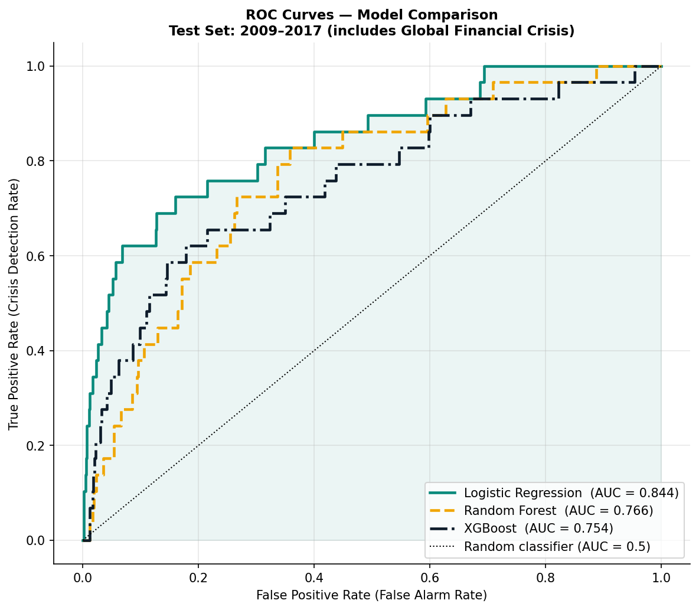
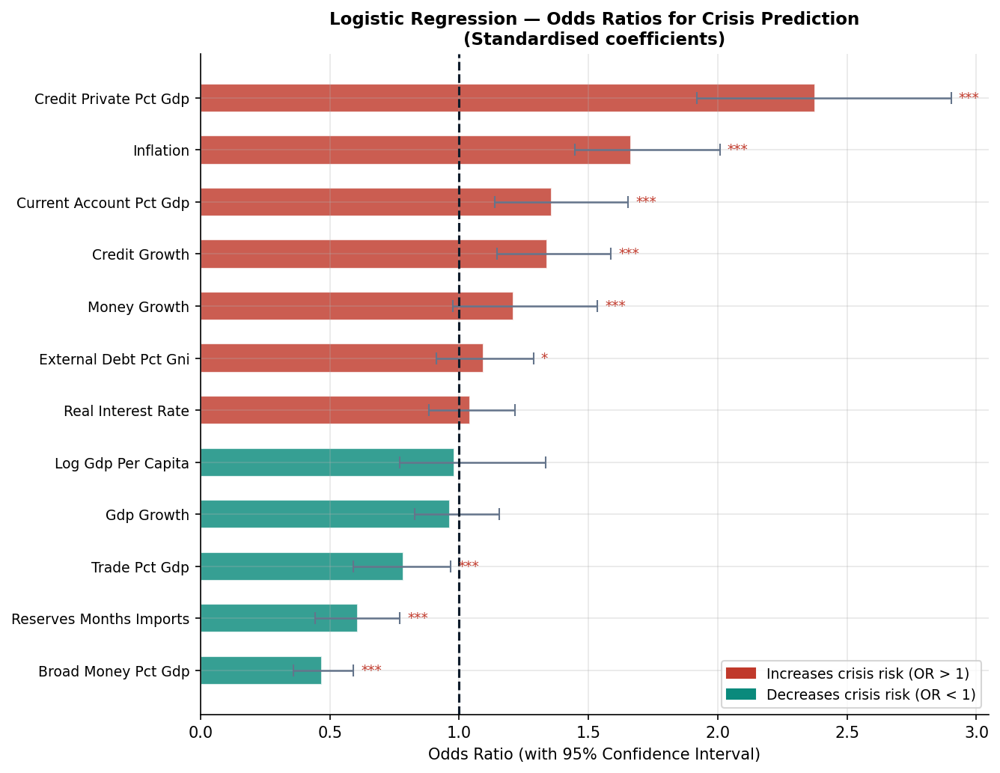

# Early-warning system for banking crises

Can a country's macro-financial data warn us **one to two years before** a banking
crisis starts? This project builds a cross-country panel, tests classic crisis theory
(Minsky, the signals approach) with logistic regression, and compares it with machine
learning on a strict time-based split.

## Results

**Simple beats complex.** On unseen years (train 1990–2008, test 2009–2017), logistic
regression ranks risky country-years best:

| Model | ROC-AUC (test) | Recall |
|---|---|---|
| **Logistic regression** | **0.844** | 0.93 |
| Random Forest | 0.766 | 0.93 |
| XGBoost | 0.754 | 0.52 |

Significant warning signals (logistic regression, α = 0.05, per 1 SD):

| Signal | Odds ratio | Reading |
|---|---|---|
| Private credit (% GDP) | 2.38 | more debt → more risk (Minsky) |
| Inflation | 1.67 | overheating economy |
| Credit growth | 1.34 | credit booms come before busts |
| FX reserves (months of imports) | 0.61 | bigger buffers protect |
| Broad money (% GDP) | 0.47 | deeper financial systems are safer |




## Method

1. **Data** – World Bank macro panel (credit, money, inflation, reserves, debt, trade,
   growth) for real countries only (regional aggregates removed), merged with the
   canonical crisis episodes from the Metrick & Schmelzing (2021) database.
2. **Target** – 1 if a crisis starts in that country within the next 1–2 years.
3. **Cleaning** – IQR-based outlier treatment, missing-value handling, multicollinearity
   check with VIF.
4. **Statistics** – Welch t-tests and Cohen's d for crisis vs. no-crisis years.
5. **Models** – logistic regression (odds ratios, 95% CI, p-values), Random Forest and
   XGBoost, all trained on 1990–2008 and tested on 2009–2017 so no future data leaks in.

Final sample: 4,378 country-year observations, 1990–2017.

## Run it

```bash
pip install -r requirements.txt
# put the crisis database in data/ (see Data)
python governance_indicators.py   # optional: World Bank governance indicators via API
python analysis.py                # all steps; charts → charts/, tables → results/
```

## Data

- **World Bank World Development Indicators** – `data/worldbank_panel.csv`
  (CC BY 4.0, <https://data.worldbank.org>).
- **Metrick & Schmelzing (2021), "Banking-Crisis Interventions, 1257–2019"**, NBER
  Working Paper 29281. Not included here; download the database
  (`Metrick-Schmelzing_Database__9-14-21_0.xlsx`) from the authors' page and place it in
  `data/`.

## Limits

- Crises are rare, so precision is low: the model flags many country-years that never
  had a crisis. It works as a ranking / watch-list tool, not a yes/no prediction.
- Governance indicators were not always available from the API, so they are optional.
- Correlation, not causation: the odds ratios describe patterns before crises.
